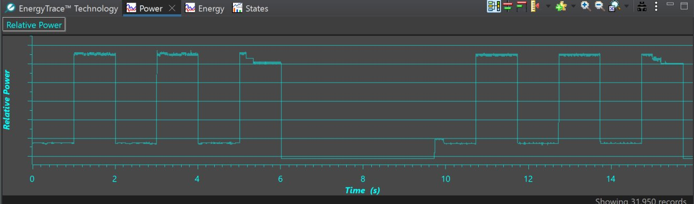
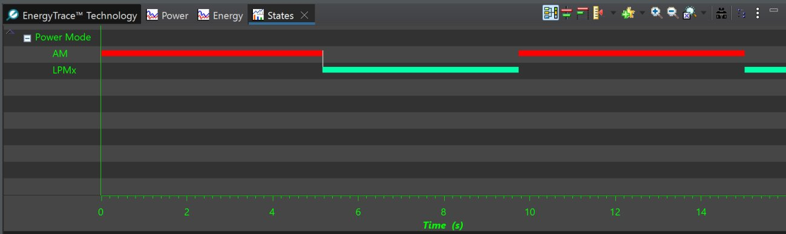
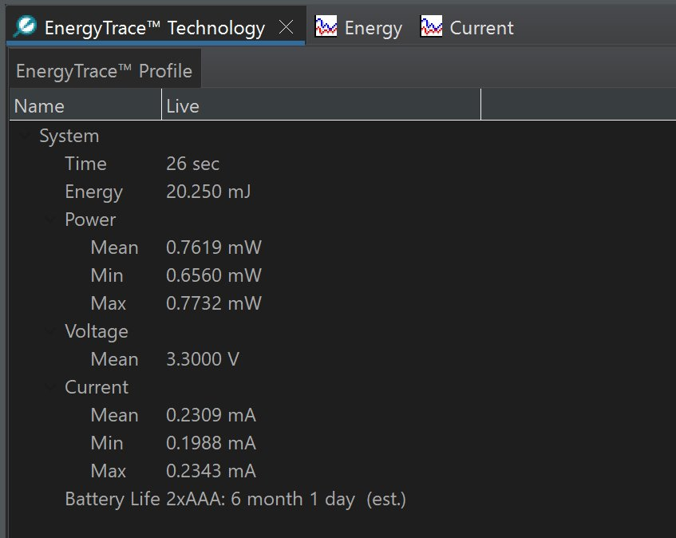
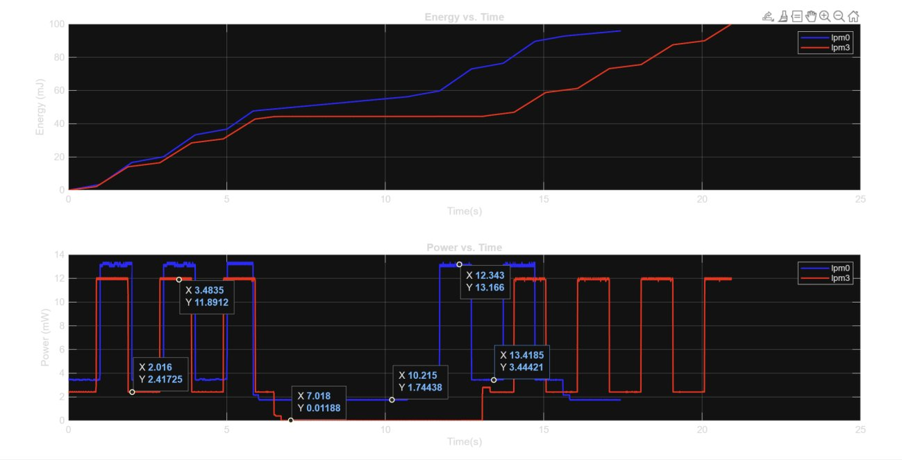

# 🔋 PowerNap — Ultra-Low-Power Firmware & Energy Profiling (MSP432)

> **Teaching a microcontroller to sleep: 200× less current, measured with EnergyTrace.**


Measures how much power an **MSP432P401R** saves in **LPM0** and **LPM3** compared with **Active Mode**, using the **WDT_A** watchdog as an interval timer, a push-button to switch modes and TI **EnergyTrace+** to profile current, power and energy.

<p align="center"></p>

## Results

| Mode | Power (mW) | Current (µA) |
|---|---|---|
| Active, LED on (debug) | 13.166 | 3989.7 |
| Active, LED on (standalone) | 11.891 | 3603.4 |
| Active, LED off (debug) | 3.444 | 1043.7 |
| Active, LED off (standalone) | 2.417 | 732.5 |
| **LPM0** | 1.744 | 528.6 |
| **LPM3** | **0.0119** | **3.60** |

Current computed as I = P / 3.3 V. **LPM3 draws ~200× less than Active Mode (LED off)** and ~150× less than LPM0.

## How It Works

```
          S2 (P1.4) falling edge                  WDT_A interval IRQ (BCLK 32.768 kHz)
   ┌───────────────┐  ───────────────►  ┌───────────────┐
   │  ACTIVE MODE  │                    │ LOW-POWER MODE│   LED1 toggles on each wake-up,
   │ LED1 blinks   │  ◄───────────────  │ CPU sleeps    │   CPU returns to sleep (__WFI)
   └───────────────┘                    └───────────────┘
```

1. Stop the watchdog, then drive **every unused GPIO (PA–PE) as output-low** to eliminate leakage.
2. LED1 on P1.0; S2 on **P1.4** with pull-up and falling-edge interrupt.
3. **WDT_A in interval mode** (`TMSEL`) clocked from **BCLK** so it keeps running in LPM3: 1 s in AM (`IS_4`), 250 ms in LPM (`IS_5`).
4. A small state machine switches modes on each button press:
   - **Active:** clear `SLEEPDEEP`; the WDT ISR blinks LED1.
   - **LPM3:** set `PCM_CTL0_LPMR__LPM3` + `SLEEPDEEP`, then `__WFI()`. (Set `LPM_MODE 0` for LPM0.)
5. Record each mode with **EnergyTrace**, export to CSV and compare in MATLAB.

## Repository Structure

```
├── src/main.c                   # AM ↔ LPM state machine, WDT interval timer
├── matlab/energytrace_plot.m    # plot exported EnergyTrace CSVs (LPM0 vs LPM3)
└── images/
```

## Build & Run

1. Create an empty **MSP432P401R** project in Code Composer Studio and replace `main.c`.
2. Choose `#define LPM_MODE 3` (or `0`), build, flash.
3. In CCS: **Run → Free Run** (or run standalone), open **EnergyTrace** (*Window → Show View → Other → EnergyTrace*) and start a capture.
4. Press **S2 (P1.4)** to switch between Active and Low-Power mode.
5. Export the capture as CSV, name it `energytrace_lpm0.csv` / `energytrace_lpm3.csv`, and run `matlab/energytrace_plot.m`.

## Gallery

| State transitions | EnergyTrace profile | MATLAB LPM0 vs LPM3 |
|---|---|---|
|  |  |  |

## Concepts Covered

- MSP432 Power Control Manager (PCM) and power modes AM, LPM0, LPM3, LPM3.5, LPM4, LPM4.5
- Clock System (CS) and which clocks survive each low-power mode
- Watchdog timer in reset vs. interval-timer mode
- Energy profiling with EnergyTrace; the effect of the debugger and of LED load on measurements

## Authors

- **Shrinath Abhay Palwankar**
- **Aryan Verma**
